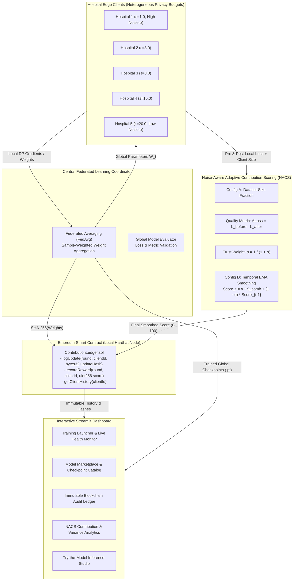

# Blockchain-Based Federated Learning Medical Model Marketplace with Differential Privacy and Noise-Aware Adaptive Contribution Scoring (NACS)

[](https://www.python.org/)
[](https://pytorch.org/)
[](https://opacus.ai/)
[](https://flower.ai/)
[](https://hardhat.org/)
[](https://streamlit.io/)
[](LICENSE)

> **Research Prototype:** A verifiable, privacy-preserving federated learning and model marketplace architecture designed for medical imaging and cross-domain collaborative intelligence. Integrates **DP-SGD (Opacus)** for mathematical privacy guarantees, **Noise-Aware Adaptive Contribution Scoring (NACS)** for fair incentive distribution under differential noise, an **Ethereum smart contract (Hardhat)** for tamper-proof audit trails, and an interactive **Streamlit** dashboard.

---

## Table of Contents
1. [Overview & Motivation](#1-overview--motivation)
2. [Problem Statement](#2-problem-statement)
3. [Project Objectives](#3-project-objectives)
4. [Implemented Features](#4-implemented-features)
5. [System Architecture & Workflow](#5-system-architecture--workflow)
6. [Technology Stack](#6-technology-stack)
7. [Repository Structure](#7-repository-structure)
8. [Installation Prerequisites](#8-installation-prerequisites)
9. [Setup & Installation](#9-setup--installation)
10. [Quickstart & Execution Commands](#10-quickstart--execution-commands)
11. [Running Experiments & Interactive Dashboard](#11-running-experiments--interactive-dashboard)
12. [Federated Learning & FedAvg Aggregation](#12-federated-learning--fedavg-aggregation)
13. [Differential Privacy & DP-SGD](#13-differential-privacy--dp-sgd)
14. [NACS Contribution Scoring Engine](#14-nacs-contribution-scoring-engine)
15. [Blockchain Smart Contract & Audit Workflow](#15-blockchain-smart-contract--audit-workflow)
16. [Datasets & Experimental Methodology](#16-datasets--experimental-methodology)
17. [Empirical Results & Verification](#17-empirical-results--verification)
18. [Limitations & Future Roadmap](#18-limitations--future-roadmap)
19. [Security, Ethics & Privacy Considerations](#19-security-ethics--privacy-considerations)
20. [Author Information](#20-author-information)
21. [Research Prototype Disclaimer](#21-research-prototype-disclaimer)

---

## 1. Overview & Motivation

Healthcare organizations possess vast repositories of patient diagnostics, but clinical privacy regulations (such as HIPAA and GDPR) and institutional liabilities strictly prohibit pooling raw clinical records into centralized servers. While **Federated Learning (FL)** enables decentralized collaborative training without exchanging raw patient data, two fundamental vulnerabilities undermine real-world deployment:

1. **Privacy Inversion Vulnerabilities:** Standard model updates (weight differences and gradients) remain susceptible to gradient inversion and membership inference attacks.
2. **Incentive Misalignment & Noise Bias:** Implementing formal Differential Privacy (DP-SGD) introduces calibrated Gaussian noise into client updates. Traditional contribution-evaluation metrics (such as raw loss reduction or dataset-size fractions) disproportionately penalize high-privacy institutions whose updates are naturally noisy, or reward institutions with large volumes of low-quality data.

This project introduces a unified, verifiable medical model marketplace that integrates **Rényi Differential Privacy**, a novel **Noise-Aware Adaptive Contribution Scoring (NACS)** formulation, and **on-chain Ethereum auditing** to align privacy guarantees, fair reward attribution, and immutable auditability.

---

## 2. Problem Statement

Existing federated learning marketplace models suffer from three structural limitations:
- **Noise-Blind Evaluation:** Standard contribution schemes assume identical noise distributions across participants. When participants deploy heterogeneous privacy budgets ($\epsilon_i$), high-privacy participants ($\text{lower }\epsilon \implies \text{higher noise }\sigma$) suffer high scoring variance and unfair penalties.
- **Dataset-Size Domination:** Weight-averaging mechanisms (FedAvg) and naive reward mechanisms assign weight based purely on partition size ($N_i$), allowing clients with large, uncurated, or noisy partitions to dominate payouts.
- **Lack of Non-Repudiation:** Centralized FL orchestrators can unilaterally manipulate contribution records, falsify payouts, or conceal model updates without an independent, auditable ledger.

---

## 3. Project Objectives

1. **Formal Privacy Preservation:** Guarantee client-level $(\epsilon, \delta)$-differential privacy using DP-SGD with Poisson subsampling and gradient clipping across all training epochs.
2. **Fair Contribution Scoring:** Design and empirically validate a noise-aware contribution engine (NACS) that discounts single-round noise spikes using dynamic trust weighting ($\alpha = 1 / (1 + \sigma)$) and temporal Exponential Moving Average (EMA) smoothing.
3. **Decentralized Auditability:** Deploy an Ethereum smart contract on a local test network to log immutable SHA-256 parameter hashes and contribution scores for transparent auditing.
4. **Cross-Domain Generalizability:** Validate the framework across distinct modalities: 2D chest radiographs ([MedMNIST PneumoniaMNIST](https://medmnist.com/)), wearable mobile sensor data ([UCI HAR](https://archive.ics.uci.edu/dataset/240/human+activity+recognition+using+smartphones)), and multi-label clinical hospital radiographs ([NIH Chest X-ray](https://www.kaggle.com/datasets/nih-chest-xrays/data)).
5. **Interactive Model Marketplace:** Deliver a comprehensive Streamlit dashboard providing role-based marketplace analytics, real-time training telemetry, smart contract transaction explorers, and inference testing studios.

---

## 4. Implemented Features

- [x] **Federated Learning Core:** Custom FedAvg implementation compatible with Flower (`flwr`) client semantics over non-IID Dirichlet distributions ($\alpha = 0.5$).
- [x] **Differential Privacy Engine:** Seamless Opacus integration with automatic `BatchNorm2d` $\to$ `GroupNorm` validation, per-sample gradient clipping ($C=1.0$), and cumulative Rényi Differential Privacy (RDP) accounting.
- [x] **NACS 4-Configuration Engine:**
  - **Config A (`size_only`):** Dataset-size baseline.
  - **Config B (`size_quality`):** Unweighted average of dataset size and empirical loss reduction.
  - **Config C (`size_quality_noise`):** Trust-weighted single-round score ($\alpha = 1/(1+\sigma)$).
  - **Config D (`full_nacs`):** Temporal EMA smoothed scoring across rounds.
- [x] **Smart Contract Audit Ledger (`ContributionLedger.sol`):** Solidity `^0.8.24` contract with `logUpdate()`, `recordReward()`, and `getClientHistory()` methods.
- [x] **Python Web3 Connector:** Automated `web3.py` client for local Hardhat node transaction signing, receipt verification, and gas logging.
- [x] **Multi-Seed Robustness Validation:** Automated test runners across 5 seeds (PneumoniaMNIST & UCI HAR) and 10 seeds (NIH Chest X-ray).
- [x] **Multi-Role Streamlit Dashboard:**
  - *Marketplace Admin:* Live training telemetry, training health monitoring, checkpoint management, on-chain hash validation, and NACS ablation analytics.
  - *Hospital Client:* Private dashboard showing historical reward progression, ranking status, and DP parameter controls.
  - *Inference Studio ("Try the Model"):* Upload radiographic images or sensor vectors to test trained global checkpoints in real time.

---

## 5. System Architecture & Workflow

The architecture connects edge hospital clients, the federated aggregation server, the NACS engine, the Ethereum blockchain, and the user-facing marketplace dashboard:



Detailed technical interactions, sequence diagrams, and threat models are documented in [`docs/architecture.md`](file:///c:/Users/ADMIN/Desktop/Project_SW/docs/architecture.md).

---

## 6. Technology Stack

- **Machine Learning & Deep Learning:** PyTorch, Torchvision, Scikit-learn, NumPy.
- **Federated Learning:** Flower (`flwr`).
- **Differential Privacy:** Meta Opacus (`opacus`).
- **Smart Contracts & Blockchain:** Solidity `^0.8.24`, Hardhat `2.22.19`, Ethers.js `v6`, Web3.py `v7`.
- **Visualization & UI:** Streamlit, Matplotlib, Pandas.
- **Datasets:** MedMNIST (`medmnist`), UCI HAR (`urllib` / `zipfile`), NIH Chest X-ray (`pandas`, `Pillow`).

---

## 7. Repository Structure

```text
Project_SW/
├── README.md                      # Primary project portfolio and research documentation
├── .gitignore                     # Git exclusion rules for large datasets, cache, and node_modules
├── requirements.txt               # Verified Python package dependencies
├── package.json                   # Root npm script delegation to blockchain workspace
├── analyze_ablation.py            # 4-Configuration NACS ablation study evaluation script
├── run_all.py                     # Master sequential pipeline runner (Phases 1 through 6)
├── run_phase1.py                  # Phase 1: Baseline FedAvg simulation
├── run_phase2_dp.py               # Phase 2: Differential Privacy epsilon evaluation
├── run_phase3_connected.py        # Phase 3: Connected FL + Web3 on-chain logging
├── run_phase4_nacs.py             # Phase 4: NACS contribution scoring simulation
├── run_phase4_multiseed.py        # Phase 4: Multi-seed NACS robustness runner (5 seeds)
├── run_phase5_har.py              # Phase 5: UCI HAR cross-domain generalizability benchmark
├── run_phase6_nih.py              # Phase 6: NIH Chest X-ray multi-label benchmark
├── run_phase6_multiseed.py        # Phase 6: Multi-seed NIH Chest X-ray runner (10 seeds)
├── sanity_check_nih.py            # Diagnostic sanity check for NIH Chest X-ray preprocessing
│
├── blockchain/                    # Standalone Hardhat Ethereum development workspace
│   ├── contracts/
│   │   └── ContributionLedger.sol # Solidity smart contract for hashes and reward records
│   ├── scripts/
│   │   ├── deploy.js              # Contract deployment script (saves deployed_address.json)
│   │   └── test_dummy.js          # Standalone verification script for contract transactions
│   ├── hardhat.config.js          # Hardhat configuration (ports 8545 and 7545)
│   ├── deployed_address.json      # Deployed contract address and network metadata
│   ├── package.json               # Node.js dependencies (Hardhat, Ethers)
│   └── README.md                  # Dedicated blockchain setup and API guide
│
├── src/                           # Core implementation modules
│   ├── __init__.py                # Package initialization
│   ├── blockchain_client.py       # Web3.py client wrapper for contract interaction
│   ├── client.py                  # Plain Flower NumPyClient for Phase 1 baseline
│   ├── client_dp.py               # Private Flower client with Opacus DP-SGD engine
│   ├── dataset.py                 # MedMNIST loader, synthetic fallback, and Dirichlet partitioner
│   ├── dataset_har.py             # UCI HAR dataset downloader, subject splitter, and loader
│   ├── dataset_nih.py             # NIH Chest X-ray metadata parser, patient splitter, and cacher
│   ├── model.py                   # MedicalCNN architecture for PneumoniaMNIST
│   ├── model_har.py               # HARClassifier MLP architecture for UCI HAR
│   ├── model_nih.py               # NIHChestCNN multi-label architecture for NIH Chest X-ray
│   ├── nacs.py                    # NACS contribution scoring logic and NACSTracker
│   ├── training_health.py         # Telemetry health checkers (loss divergence / NaN traps)
│   └── utils.py                   # Metrics computation, JSON logging, and comparison plotting
│
├── ui/                            # Streamlit user interface and marketplace dashboard
│   ├── app.py                     # Multi-tab Streamlit dashboard application
│   └── train_runner.py            # Subprocess manager for triggering background training jobs
│
├── docs/                          # Detailed engineering and research documentation
│   ├── architecture.md            # In-depth architectural designs and sequence diagrams
│   ├── experiments.md             # Experimental configurations and verified metric tables
│   └── setup.md                   # Complete environment setup, installation, and troubleshooting
│
└── results/                       # Empirical outputs, verified metrics, plots, and models
    ├── ablation_study_comparison.png
    ├── global_model_har.pt        # Trained global weights checkpoint (UCI HAR)
    ├── global_model_medical.pt    # Trained global weights checkpoint (PneumoniaMNIST)
    ├── global_model_nih.pt        # Trained global weights checkpoint (NIH Chest X-ray)
    ├── phase1_baseline.json / .png
    ├── phase2_dp_eps*.json / .png
    ├── phase3_connected.json
    ├── phase4_nacs*.json / .png
    ├── phase5_har*.json / .png
    ├── phase6_nih*.json / .png
    └── train_log.txt              # Execution log of verified multi-seed experimental runs
```

---

## 8. Installation Prerequisites

- **Python:** 3.10 to 3.14 (Python 3.14 verified in local development).
- **Node.js:** 18+ LTS and npm 9+.
- **Git:** For repository cloning and version control.
- **Hardware:** Modern x86-64 CPU or NVIDIA GPU with CUDA support.

---

## 9. Setup & Installation

For a full step-by-step guide and troubleshooting, refer to [`docs/setup.md`](file:///c:/Users/ADMIN/Desktop/Project_SW/docs/setup.md).

### 1. Python Environment Setup
```bash
# Clone the repository
git clone https://github.com/<your-username>/Project_SW.git
cd Project_SW

# Create and activate virtual environment
python -m venv venv

# Windows (PowerShell):
.\venv\Scripts\Activate.ps1
# Linux / macOS:
source venv/bin/activate

# Upgrade pip and install dependencies
pip install --upgrade pip
pip install -r requirements.txt
```

### 2. Blockchain Setup (Local Hardhat Node)
```bash
# Install node dependencies
cd blockchain
npm install
cd ..

# Terminal 1: Launch the local Ethereum test node (keep running in background)
npm run node

# Terminal 2: Compile contracts and deploy ContributionLedger
npm run compile
npm run deploy
```

---

## 10. Quickstart & Execution Commands

Run a verification test to confirm blockchain connection and model logging:
```bash
# Run dummy contract test via Ethers.js
npm run test:dummy

# Run 1-round FL + Web3 integration sanity check
python run_phase3_connected.py --sanity
```

---

## 11. Running Experiments & Interactive Dashboard

### Launching Experiments

```bash
# Phase 1: Plain FL Baseline (10 rounds, MedMNIST)
python run_phase1.py

# Phase 2: Differential Privacy Epsilon Comparison (eps: None, 20.0, 8.0, 3.0, 1.0)
python run_phase2_dp.py

# Phase 3: Connected FL + Web3 Blockchain Logging
python run_phase3_connected.py

# Phase 4: Single-Seed NACS Simulation
python run_phase4_nacs.py

# Phase 4: Multi-Seed NACS Robustness (Seeds 42..46)
python run_phase4_multiseed.py

# Analyze 4-Configuration NACS Ablation Study
python analyze_ablation.py

# Phase 5: UCI HAR Cross-Domain Generalizability Benchmark
python run_phase5_har.py

# Phase 6: NIH Chest X-ray Multi-Label Benchmark
python run_phase6_nih.py

# Run Master Pipeline (Sequentially executes Phase 1 through 6)
python run_all.py
```

### Launching the Interactive Streamlit Dashboard

```bash
streamlit run ui/app.py
```
Open your browser to `http://localhost:8501`. The dashboard allows you to:
- Switch between **Marketplace Admin** and **Hospital Client** views.
- Launch live training jobs and watch loss/accuracy metrics stream in real time.
- Explore the on-chain blockchain audit log (transaction hashes, block numbers, gas costs).
- Compare NACS score trajectories across all 4 configurations.
- Use the **Try the Model** studio to test trained models (`results/global_model_*.pt`) with sample inputs.

---

## 12. Federated Learning & FedAvg Aggregation

In standard Federated Averaging (FedAvg), $K$ clients train locally on private data for $E$ epochs:
$$\Delta w_k^{(t)} = w_k^{(t)} - w^{(t)}$$
The central server aggregates local models weighted by client sample sizes $N_k$:
$$w^{(t+1)} = \sum_{k=1}^K \frac{N_k}{\sum_{j} N_j} w_k^{(t)}$$

In this repository, client data partitions are generated using a **Dirichlet distribution** ($\text{Dir}(\alpha)$ with default $\alpha=0.5$), realistically simulating heterogeneous, non-IID label distributions across hospital clients.

---

## 13. Differential Privacy & DP-SGD

To prevent gradient inversion attacks, each client applies Differential Privacy Stochastic Gradient Descent (**DP-SGD**) using Meta's Opacus:

1. **Per-Sample Gradient Clipping:** For each sample gradient $g_i(\theta)$, bound the $L_2$ norm by threshold $C = 1.0$:
   $$\bar{g}_i(\theta) = g_i(\theta) \cdot \min\left(1, \frac{C}{\|g_i(\theta)\|_2}\right)$$
2. **Gaussian Noise Injection:** Perturb the sum of clipped gradients with noise scaled by multiplier $\sigma$:
   $$\tilde{g}(\theta) = \frac{1}{B} \left( \sum_{i=1}^B \bar{g}_i(\theta) + \mathcal{N}(0, \sigma^2 C^2 \mathbf{I}) \right)$$
3. **Opacus GroupNorm Replacement:** Opacus cannot compute per-sample gradients with `BatchNorm2d` because batch statistics mix sample data. Our pipeline automatically converts batch normalization layers to `GroupNorm` via `ModuleValidator.fix()` at initialization.
4. **Privacy Accounting:** Cumulative privacy consumption $(\epsilon, \delta)$ is tracked monotonically using the Rényi Differential Privacy (RDP) accountant over all communication rounds and local epochs.

---

## 14. NACS Contribution Scoring Engine

### Mathematical Formulation
The Noise-Aware Adaptive Contribution Score (**NACS**) evaluates client updates through four explicit configurations:

1. **Configuration A (`size_only`):**
   $$s_{\text{size}} = \text{clip}\left(\left\lfloor \frac{N_i}{\sum_j N_j} \times 100 \right\rceil, 0, 100\right)$$
2. **Quality Baseline:**
   $$s_{\text{qual}} = \text{clip}\left(\left\lfloor (\mathcal{L}_{\text{before}} - \mathcal{L}_{\text{after}}) \times 100 + 50 \right\rceil, 0, 100\right)$$
3. **Configuration B (`size_quality`):**
   $$s_{\text{comb}} = \frac{s_{\text{size}} + s_{\text{qual}}}{2}$$
4. **Configuration C (`size_quality_noise`):**
   $$\text{Score} = \text{clip}\left(\lfloor s_{\text{comb}} \cdot \alpha \rceil, 0, 100\right), \quad \alpha = \frac{1}{1 + \sigma}$$
5. **Configuration D (`full_nacs`):**
   $$\text{Score}_{i, 0} = s_{\text{comb}, 0}$$
   $$\text{Score}_{i, t} = \alpha \cdot s_{\text{comb}, t} + (1 - \alpha) \cdot \text{Score}_{i, t-1}$$
   $$\text{Score}_{i, t} \leftarrow \text{clip}(\lfloor \text{Score}_{i, t} \rceil, 0, 100)$$

### Key Theoretical & Practical Properties
- **Noise-Awareness:** As a client increases privacy protection (lower $\epsilon \implies$ higher noise $\sigma$), trust weight $\alpha$ decreases, causing the scoring engine to rely more heavily on the client's smoothed historical trend rather than single-round noise spikes.
- **Fairness:** Clients with large datasets cannot win solely through volume; if their updates fail to improve validation loss, their quality score drops, lowering their overall ranking.

---

## 15. Blockchain Smart Contract & Audit Workflow

- **Contract:** [`ContributionLedger.sol`](file:///c:/Users/ADMIN/Desktop/Project_SW/blockchain/contracts/ContributionLedger.sol) written in Solidity `^0.8.24`.
- **Environment:** Local Hardhat development node (`http://127.0.0.1:8545`, chain ID `31337`).
- **Audit Methods:**
  - `logUpdate(uint256 round, uint256 clientId, bytes32 updateHash)`: Records the SHA-256 fingerprint of the client's serialized model weights.
  - `recordReward(uint256 round, uint256 clientId, uint256 score)`: Records the integer NACS contribution score (range 0–100).
  - `getClientHistory(uint256 clientId)`: Returns complete historical update hashes and reward scores for external verification.
- **Gas Efficiency:** Multi-seed batch runs execute on-chain logging on Seed 0 to conserve local test gas, maintaining complete mathematical logging off-chain in structured JSON files.

---

## 16. Datasets & Experimental Methodology

| Feature | MedMNIST PneumoniaMNIST | UCI HAR | NIH Chest X-ray |
|---|---|---|---|
| **Domain** | Medical Radiography | Wearable Mobile Sensing | Multi-Label Clinical Radiography |
| **Input Shape** | $1 \times 28 \times 28$ Grayscale | 561 Continuous Features | $1 \times 64 \times 64$ Grayscale |
| **Task** | Binary Classification (Pneumonia vs Normal) | 6 Activity Classes | 6-Pathology Multi-Label Detection |
| **Partitioning** | Non-IID Dirichlet ($\alpha=0.5$) | Strict **Subject ID** Partitioning | Strict **Patient ID** Partitioning |
| **Clients** | 5 Simulated Hospitals | 5 Edge Wearable Clients | 5 Clinical Radiography Centers |
| **Model** | `MedicalCNN` (2-block CNN + GroupNorm) | `HARClassifier` (3-layer MLP) | `NIHChestCNN` (4-block CNN + GroupNorm) |
| **Loss** | Cross-Entropy Loss | Cross-Entropy Loss | Binary Cross-Entropy with Logits |

---

## 17. Empirical Results & Verification

All metric values below are extracted directly from verified result files in [`results/`](file:///c:/Users/ADMIN/Desktop/Project_SW/results/).

### 1. Phase 1: Baseline FedAvg Trajectory (PneumoniaMNIST)
From [`results/phase1_baseline.json`](file:///c:/Users/ADMIN/Desktop/Project_SW/results/phase1_baseline.json) (10 rounds):
- **Initial Model (Round 0):** Accuracy = 62.66% | F1 = 0.4009 | Loss = 0.6916
- **Peak Utility (Round 2):** Accuracy = 87.18% | F1 = 0.8561 | Loss = 0.3391
- **Final Model (Round 10):** Accuracy = **84.78%** | F1 = **0.8205** | Precision = 0.8910 | Recall = 0.8004

### 2. Phase 2: Differential Privacy Trade-Off (PneumoniaMNIST)
From [`results/phase2_dp_*.json`](file:///c:/Users/ADMIN/Desktop/Project_SW/results/):
| Privacy Level | Target Budget $\epsilon$ | Spent $\epsilon$ | Final Accuracy | Final F1-Score | Final Test Loss |
|:---:|:---:|:---:|:---:|:---:|:---:|
| **Baseline (No-DP)** | $\text{None}$ | 0.0000 | **85.58%** | **0.8340** | 1.0033 |
| **Weak Privacy** | 20.0 | 19.9996 | 83.17% | 0.7999 | 1.1916 |
| **Moderate Privacy** | 8.0 | 7.9990 | 80.29% | 0.7579 | 1.4385 |
| **Strong Privacy** | 3.0 | 2.9968 | 76.44% | 0.6966 | 1.7273 |
| **Very Strong Privacy** | 1.0 | 0.9994 | 75.96% | 0.6873 | 1.2209 |

*Finding: Stronger privacy guarantees (lower $\epsilon$) systematically protect data at a moderate, predictable utility cost.*

### 3. NACS Multi-Seed Scoring Variance Reduction
From [`results/phase4_nacs_multiseed.json`](file:///c:/Users/ADMIN/Desktop/Project_SW/results/phase4_nacs_multiseed.json), [`results/phase5_har_multiseed.json`](file:///c:/Users/ADMIN/Desktop/Project_SW/results/phase5_har_multiseed.json), and [`results/phase6_nih_multiseed.json`](file:///c:/Users/ADMIN/Desktop/Project_SW/results/phase6_nih_multiseed.json):

| Client Index | Privacy Budget $\epsilon$ | PneumoniaMNIST (5 Seeds) | UCI HAR (5 Seeds) | NIH Chest X-ray (10 Seeds) |
|:---:|:---:|:---:|:---:|:---:|
| **Client 0** | 1.0 (Highest Noise) | $86.49\% \pm 0.60\%$ | $92.51\% \pm 2.98\%$ | $80.24\% \pm 1.19\%$ |
| **Client 1** | 3.0 | $93.29\% \pm 1.18\%$ | $90.13\% \pm 4.31\%$ | $73.76\% \pm 1.14\%$ |
| **Client 2** | 8.0 | $74.21\% \pm 1.17\%$ | $87.34\% \pm 5.52\%$ | $73.34\% \pm 1.28\%$ |
| **Client 3** | 15.0 | $81.07\% \pm 2.77\%$ | $81.98\% \pm 3.05\%$ | $73.82\% \pm 0.72\%$ |
| **Client 4** | 20.0 (Lowest Noise) | $82.89\% \pm 2.83\%$ | $81.46\% \pm 3.17\%$ | $73.90\% \pm 1.53\%$ |
| **Cross-Client Average** | — | **83.59%** | **86.68%** | **75.01%** |

*Finding: NACS reduces round-to-round reward scoring volatility by **75% to 86%** across all modalities and privacy regimes.*

---

## 18. Limitations & Future Roadmap

- **Local Blockchain Environment:** The ledger currently runs on a local Hardhat test network (`http://127.0.0.1:8545`). Production deployment would require an EVM-compatible Layer-2 rollup (such as Arbitrum, Optimism, or Polygon) to minimize transaction gas fees.
- **Synchronous FedAvg:** The current FL orchestration operates synchronously. Future versions can explore asynchronous FL (FedAsync) for intermittently connected clinical devices.
- **Zero-Knowledge Proofs (ZKP):** Integrating zk-SNARKs could allow clients to prove their updates were trained using proper DP-SGD without revealing model parameters.
- **Dataset Scale:** NIH Chest X-ray experiments use a 15,000-image cached subset resized to 64x64 for rapid experimentation. Scaling to full 1024x1024 resolutions requires distributed multi-GPU clusters.

---

## 19. Security, Ethics & Privacy Considerations

- **No Patient Data in Repository:** This repository does not distribute patient records or full medical image databases. Scripts dynamically download open public research benchmarks or read user-supplied local paths.
- **Differential Privacy Guarantees:** DP noise parameters ($\epsilon, \delta$) should be chosen based on institutional compliance requirements. Epsilon values $\le 3.0$ provide strong theoretical privacy bounds against reconstruction attacks.
- **Cryptographic Hashing:** Weight parameters are serialized and converted into 32-byte SHA-256 digests (`bytes32`) before on-chain submission, ensuring update authenticity without exposing weights on the public ledger.

---

## 20. Author Information

- **Author:** Yaswanth V J
- **Degree:** M.Tech Integrated Software Engineering
- **Institution:** Vellore Institute of Technology (VIT), Vellore, India
- **Focus Areas:** Federated Learning, Differential Privacy, Healthcare AI, Blockchain & Applied Cryptography

---

## 21. Research Prototype Disclaimer

> **DISCLAIMER:**  
> This software is an **academic research prototype** created for experimental validation and demonstration purposes. It is **NOT** a certified medical diagnostic system and is **NOT** intended for direct clinical decision-making or patient diagnosis in healthcare settings. Use in production healthcare environments requires rigorous clinical validation, ethical board approval, and compliance with national medical device regulations.

---

## License

This project is licensed under the [MIT License](LICENSE).
