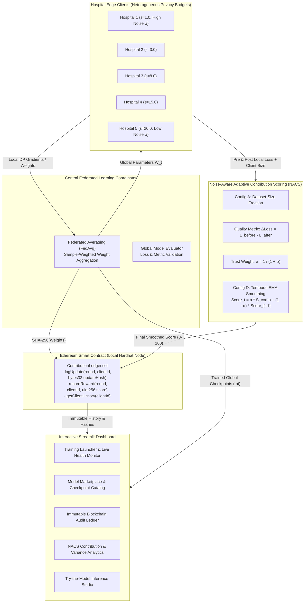
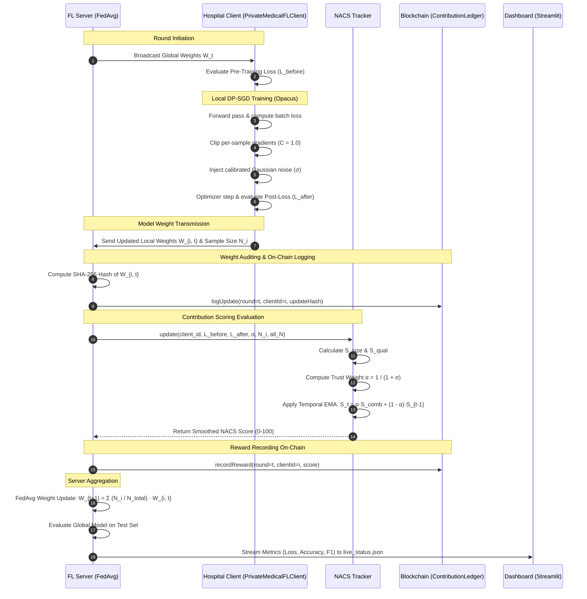

# System Architecture and Technical Workflow

This document details the system design, communication flow, and security mechanisms of the **Blockchain-Based Federated Learning Medical Model Marketplace with Differential Privacy and Noise-Aware Adaptive Contribution Scoring (NACS)**.

---

## 1. System Overview

The framework unites five core subsystems to establish a privacy-preserving, auditable, and incentive-aligned medical model marketplace:

---

## 2. End-to-End FL Round Sequence

In each communication round $t$, the system transitions through the following lifecycle:

---

## 3. Core Component Design

### 3.1. Edge Client & DP-SGD Implementation
- **Source:** [`src/client_dp.py`](file:///c:/Users/ADMIN/Desktop/Project_SW/src/client_dp.py)
- **Framework:** PyTorch & Opacus (`PrivacyEngine`)
- **Key Design Principles:**
  - **Single Engine Lifetime:** The `PrivacyEngine` is instantiated once during client initialization, calibrated against `total_rounds * local_epochs` total training epochs. This ensures Opacus's Rényi Differential Privacy (RDP) accountant measures monotonic privacy leakage across the entire federated run without resets.
  - **Opacus Module Validation:** Standard PyTorch `BatchNorm2d` violates sample-level independence required by DP-SGD because batch statistics correlate individual training instances. `ModuleValidator.fix()` automatically converts `BatchNorm2d` to `GroupNorm` at construction time without altering external architecture interfaces.
  - **Gradient Clipping:** Per-sample gradient $L_2$ norm clipping threshold $C = 1.0$.

### 3.2. Noise-Aware Adaptive Contribution Scoring (NACS)
- **Source:** [`src/nacs.py`](file:///c:/Users/ADMIN/Desktop/Project_SW/src/nacs.py)
- **Problem Solved:** Traditional federated learning rewards clients either solely by dataset size ($N_i$), which encourages low-quality or fabricated data submissions, or by raw loss reduction ($\Delta \mathcal{L}$), which penalizes privacy-preserving clients whose gradients are perturbed by legitimate differential privacy noise.
- **Formulation:**
  1. **Dataset-Size Score (Config A):**
     $$s_{\text{size}} = \text{clip}\left(\left\lfloor \frac{N_i}{\sum_{j} N_j} \times 100 \right\rceil, 0, 100\right)$$
  2. **Noise-Blind Quality Score:**
     $$s_{\text{qual}} = \text{clip}\left(\left\lfloor (\mathcal{L}_{\text{before}} - \mathcal{L}_{\text{after}}) \times 100 + 50 \right\rceil, 0, 100\right)$$
  3. **Combined Raw Score:**
     $$s_{\text{comb}} = \frac{s_{\text{size}} + s_{\text{qual}}}{2}$$
  4. **Noise Trust Weight:**
     $$\alpha = \frac{1}{1 + \sigma}$$
     *(Where $\sigma$ is the client's calibrated DP Gaussian noise multiplier)*
  5. **Temporal Exponential Moving Average (Config D / Full NACS):**
     $$\text{Score}_{i, 0} = s_{\text{comb}, 0}$$
     $$\text{Score}_{i, t} = \alpha \cdot s_{\text{comb}, t} + (1 - \alpha) \cdot \text{Score}_{i, t-1}$$
     $$\text{Score}_{i, t} \leftarrow \text{clip}(\lfloor \text{Score}_{i, t} \rceil, 0, 100)$$

### 3.3. Blockchain Ledger Subsystem
- **Source:** [`blockchain/contracts/ContributionLedger.sol`](file:///c:/Users/ADMIN/Desktop/Project_SW/blockchain/contracts/ContributionLedger.sol) & [`src/blockchain_client.py`](file:///c:/Users/ADMIN/Desktop/Project_SW/src/blockchain_client.py)
- **Environment:** Local Hardhat EVM development network (`chainId: 31337`, port `8545`).
- **Data Logged:**
  - `UpdateEntry(uint256 round, bytes32 updateHash)`: Cryptographic SHA-256 fingerprint of the client's serialized model weights (`pickle.dumps(weights)`).
  - `RewardEntry(uint256 round, uint256 score)`: Integer contribution reward score in range $[0, 100]$.
- **Events Emitted:**
  - `event UpdateLogged(uint256 indexed round, uint256 indexed clientId, bytes32 updateHash)`
  - `event RewardRecorded(uint256 indexed round, uint256 indexed clientId, uint256 score)`

### 3.4. Interactive Streamlit Dashboard
- **Source:** [`ui/app.py`](file:///c:/Users/ADMIN/Desktop/Project_SW/ui/app.py) & [`ui/train_runner.py`](file:///c:/Users/ADMIN/Desktop/Project_SW/ui/train_runner.py)
- **Role-Based Experience:**
  - **Marketplace Admin / Researcher:** Interactive training trigger, live loss/accuracy chart polling, smart contract audit exploration, NACS 4-configuration ablation analysis, and global model download.
  - **Hospital Client View:** Local contribution score history, ranking position, on-chain reward proofs, and DP privacy budget controls.
  - **Inference Studio ("Try the Model"):** Upload real chest X-ray images or sensor arrays to run client-side inference against trained global model weights ([`results/*.pt`](file:///c:/Users/ADMIN/Desktop/Project_SW/results/)).

---

## 4. Threat Model and Security Guarantees

| Attack Vector | Vulnerability in Standard FL | Mitigation in Proposed Framework |
|---------------|------------------------------|-----------------------------------|
| **Gradient Inversion / Reconstruction Attack** | Eavesdropper or semi-honest server reconstructs raw patient images from unshielded gradient updates. | **DP-SGD via Opacus:** Per-sample gradient clipping ($C=1.0$) and calibrated Gaussian noise injection ensure formal $(\epsilon, \delta)$-differential privacy guarantees. |
| **Free-Rider / Low-Quality Data Attack** | Clients send random or empty updates to harvest rewards without computational investment. | **Quality-Aware Scoring:** NACS evaluates empirical loss reduction ($\mathcal{L}_{\text{before}} - \mathcal{L}_{\text{after}}$) on local validation partitions. |
| **Noise-Induced Reward Penalty** | Standard quality scoring penalizes high-privacy clients whose gradient updates naturally exhibit higher variance. | **Noise-Aware Trust Weight & EMA:** High noise levels reduce $\alpha$, placing greater weight on smoothed historical performance rather than single-round noise spikes. |
| **Reward Tampering / Repudiation** | Server or client falsifies contribution records or denies submitting specific model weights. | **Immutable Ethereum Ledger:** All parameter weight hashes (`bytes32`) and reward points are permanently committed to an on-chain ledger with emitted event logs. |
